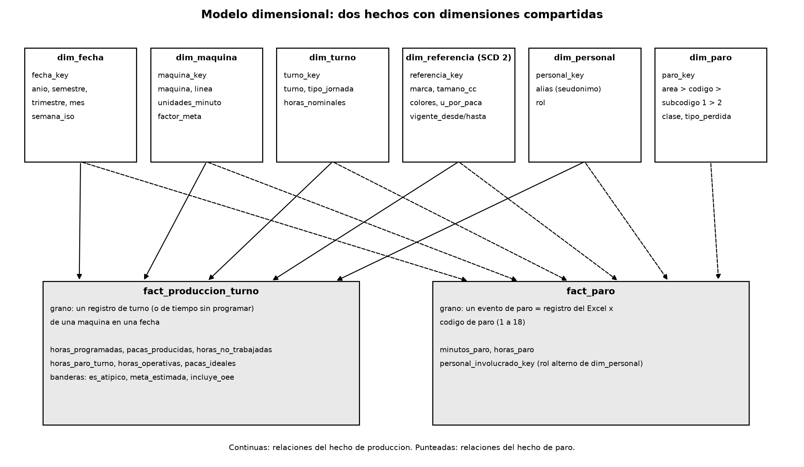

# BI de paros y productividad en envasado (P-MTO-22)

Proyecto del Taller 5 de Inteligencia de Negocios. Parte del libro de seguimiento de las líneas de envasado de témperas y vinilos (Vinilos_1 a Vinilos_4, 2022 a marzo de 2025) y llega a un modelo dimensional en PostgreSQL, un informe en Power BI y un tablero con alertas en Grafana.

Integrantes: Samuel Vélez Guzmán y Kevyn Alejandro Patiño Duque. Docente: Ramiro Grisales Montoya.

## Qué hay en el repositorio

| Carpeta | Contenido |
|---|---|
| `etl/` | ETL en Python (extracción, limpieza, carga, conciliación) y el simulador de lecturas por hora |
| `sql/` | Esquemas, tablas, índices, vistas, consultas analíticas, conciliación y permisos, numerados en el orden de ejecución |
| `powerbi/` | Proyecto de Power BI en formato PBIP (modelo semántico en TMDL e informe de 4 páginas) |
| `grafana/` | Data source, tablero y alertas como archivos de provisioning |
| `docker/` y `docker-compose.yml` | Entorno completo con un comando (opcional) |
| `docs/` | Documentación del taller, de la 01 a la 09 |
| `data/raw/` | Aquí va el libro de Excel. No se sube al repositorio |

## Documentación

1. [Usuarios y preguntas de negocio](docs/01_usuarios_y_preguntas.md)
2. [Diagnóstico de la fuente](docs/02_diagnostico_fuente.md)
3. [Catálogo de indicadores](docs/03_catalogo_indicadores.md)
4. [Modelo dimensional](docs/04_modelo_dimensional.md)
5. [Diccionario de datos](docs/05_diccionario_datos.md)
6. [ETL y calidad de datos](docs/06_etl_y_calidad.md)
7. [Arquitectura, comparativo Power BI y Grafana, evolución a PLC](docs/07_arquitectura_y_comparativo.md)
8. [Datos personales y seguridad](docs/08_privacidad_y_seguridad.md)
9. [Hallazgos y recomendaciones](docs/09_hallazgos_y_recomendaciones.md)

## Modelo en una línea

Dos tablas de hechos (`fact_produccion_turno`, un registro de turno de una máquina en una fecha; `fact_paro`, un evento de paro por cada código con minutos) que comparten dimensiones de fecha, máquina, turno, referencia, personal y paro. Detalle en el documento 4.



## Cómo reproducirlo desde cero

Se necesita Python 3.10 o superior, PostgreSQL 14 o superior y el libro `SEGUIMIENTO TEMPERAS Y VINILOS Actividad.xlsm`.

1. Clonar e instalar las dependencias.

```bash
git clone https://github.com/CodeByKevyn/bi-oee-pmto22.git
cd bi-oee-pmto22
python -m venv .venv
.venv/Scripts/activate
pip install -r etl/requirements.txt
```

2. Crear el archivo de configuración y completar los valores (contraseña de PostgreSQL y una sal cualquiera para los alias de las personas). El `.env` está en `.gitignore`.

```bash
cp .env.example .env
```

3. Copiar el libro a `data/raw/` (o cambiar `XLSM_PATH` en el `.env`).

4. Correr el ETL. Crea la base `bi_oee` si no existe, ejecuta los scripts de `sql/`, carga y concilia.

```bash
python etl/run_etl.py
```

Al final imprime la conciliación de los cuatro totales (horas programadas, pacas, horas sin trabajar y horas de paro) y guarda el resultado en `docs/reporte_etl.json`. Se puede repetir sin duplicar datos. Para empezar de cero:

```bash
python etl/run_etl.py --reset
```

5. Consultas de análisis y de conciliación: abrir en DBeaver `sql/08_consultas_analiticas.sql` y `sql/09_conciliacion.sql`.

## Power BI

Abrir `powerbi/BI_OEE.pbip` con Power BI Desktop. Los parámetros `Servidor` y `BaseDeDatos` apuntan a `localhost:5432` y `bi_oee`; se cambian en Transformar datos > Administrar parámetros. Al actualizar pide las credenciales de PostgreSQL, que no se guardan en el proyecto.

Se usó PBIP y no un `.pbix` porque el `.pbix` es un binario: Git no muestra qué cambió ni permite combinar el trabajo de dos personas. El PBIP guarda el modelo y el informe como texto.

Páginas: Resumen, Paros (Pareto y jerarquía de paros con drill), Máquinas y turnos, y Comparativo anual. Las medidas están en la tabla `Medidas` del modelo.

## Grafana y tiempo real

Con Docker y el libro ya copiado en `data/raw/`, un solo comando levanta PostgreSQL con los scripts de `sql/`, Grafana con el data source, el tablero y las alertas ya cargados, y carga el modelo desde el libro:

```bash
docker compose up -d
```

Grafana queda en http://localhost:3000 con el usuario y la contraseña de `GRAFANA_ADMIN_USER` y `GRAFANA_ADMIN_PASSWORD` del `.env`. Los datos de la base están en un volumen, así que sobreviven a un `docker compose down`.

Para generar lecturas hora a hora (cada hora simulada dura unos segundos) y ver el tablero moverse:

```bash
docker compose --profile simulador up simulador
```

Para provocar la falla que dispara la alerta (paro de más del 50 % en las últimas 3 horas), con el entorno local:

```bash
python etl/simulador_hora.py --prefill 24 --segundos-por-hora 5 --falla
```

Sin Docker, hay que instalar Grafana, definir las variables `PGHOST`, `PGPORT`, `PGDATABASE`, `GRAFANA_DB_USER` y `GRAFANA_DB_PASSWORD`, crear el usuario de lectura (ver `docker/12_usuario_grafana.sh`) y apuntar `GF_PATHS_PROVISIONING` a `grafana/provisioning`.

Las alertas `oee-paro-3h-v1` a `v4` (una por máquina) se evalúan cada 10 segundos y avisan cuando el paro de las últimas tres horas pasa del 50 %. El umbral se justifica en el documento 3.

## Seguridad

No hay contraseñas ni cadenas de conexión en el código: todo sale del `.env`, que no se versiona. Los nombres de las personas se reemplazan por un alias al leer el libro y nunca llegan a la base. Las herramientas de BI usan un rol de solo lectura que no ve el esquema `stg`. Más en el documento 8.

El historial anterior del repositorio todavía contiene la contraseña de desarrollo de PostgreSQL y un CSV con nombres, que se retiraron del código actual. Esa contraseña se debe cambiar.

## Limitaciones conocidas

- La calidad del OEE se aproxima con el tiempo de reproceso y materia prima defectuosa, porque el libro no trae unidades defectuosas.
- 4.047 filas de producción no tienen referencia y su meta por hora es estimada; esas filas no entran al OEE.
- Las metas salen de percentiles de la historia y falta validarlas con producción.
- Las consultas del tablero y de las alertas se probaron contra la base de datos. Falta confirmar la carga automática en una instancia de Grafana y el arranque con `docker compose` en un equipo con Docker.
