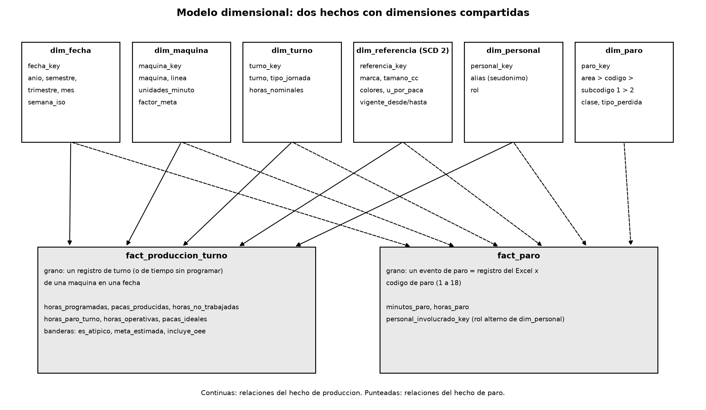

# 4. Modelo dimensional

## Por qué un esquema en estrella (constelación de hechos)

Se eligió el modelo dimensional de Kimball, con dos tablas de hechos que comparten dimensiones, por estas razones:

- Las preguntas son analíticas: sumar horas y pacas y cortarlas por fecha, máquina, turno, referencia y código de paro. Una estrella responde eso con uniones simples y rápidas.
- Power BI trabaja mejor con tablas de hechos estrechas y dimensiones pequeñas con relaciones uno a muchos, y las medidas DAX quedan cortas.
- Una sola tabla plana (lo que tenía el repositorio al inicio) repite en cada fila los textos de máquina, referencia y turno, y no permite jerarquías ni cambios de atributos.
- Un modelo normalizado (3FN) sirve para capturar datos, no para analizarlos: obligaría a unir 8 o 9 tablas en cada consulta.
- Se descartó copo de nieve (snowflake) porque las dimensiones son pequeñas (sin contar la de fechas, la mayor tiene 65 filas) y normalizarlas no ahorra nada.

## Granularidad de cada tabla de hechos

| Tabla | Grano |
|---|---|
| `dwh.fact_produccion_turno` | Un registro de turno de una máquina en una fecha, con una operaria y una referencia. También guarda los registros de "tiempo sin programar" (máquina sin turno programado), con horas programadas en cero y las horas sin trabajar |
| `dwh.fact_paro` | Un evento de paro: un registro del Excel multiplicado por cada código de paro (1 a 18) con minutos mayores que cero |
| `rt.lectura_hora` | Una lectura por máquina y por hora (simulada), para Grafana |

Se separaron en dos hechos porque tienen granos distintos: la producción es una por turno y los paros son varios por turno. Mezclarlos en una sola tabla repetiría las pacas en cada paro y duplicaría las sumas.

## Dimensiones

| Dimensión | Atributos | Jerarquía |
|---|---|---|
| `dim_fecha` (construida por nosotros) | fecha, año, semestre, trimestre, mes, nombre del mes, año-mes, semana ISO, día, día de la semana, fin de semana. Cubre 2022 a 2027 sin saltos | Año > Trimestre > Mes > Día |
| `dim_maquina` | máquina, línea, unidades por minuto, factor de la meta | Máquina (línea = máquina) |
| `dim_turno` (construida por nosotros) | turno normalizado, tipo de jornada (turno de 8 h o jornada especial), horas nominales, minutos de aseo y de pausa activa | Tipo de jornada > Turno |
| `dim_referencia` | referencia, marca, tamaño en cc, colores, display por paca, unidades por paca, vigencia | Marca > Tamaño > Referencia |
| `dim_personal` | alias (seudónimo), rol (operaria, mantenimiento) | Rol > Alias |
| `dim_paro` (construida por nosotros) | código, nombre, área de impacto, subcódigo nivel 1 y 2, clase (programado o no programado), tipo de pérdida del OEE | Área de impacto > Código > Subcódigo 1 > Subcódigo 2 |

Las tres marcadas como "construidas por nosotros" no existen en el Excel: `dim_fecha` se genera, `dim_turno` parte de siete textos libres y `dim_paro` junta el catálogo de códigos con la clasificación que se agregó (programado o no, y a qué pérdida del OEE pertenece).

Cada dimensión tiene un miembro "desconocido" (llave 0 en referencia y personal, `Sin turno` en turno) para que ningún hecho quede con llave nula.

## Cómo se modela la jerarquía de los paros

El paro se organiza en cuatro niveles: **área de impacto** (mantenimiento, producción, calidad, almacén, paro programado), **código** (1 a 18), **subcódigo de nivel 1** (por ejemplo `1.2 Sistema de dosificación`) y **subcódigo de nivel 2** (por ejemplo `1.2.C Cambio de válvula`). Solo los códigos 1, 3 y 5 tienen subcódigos.

Se guardó aplanada en una sola dimensión (`dim_paro`), una fila por hoja de la jerarquía, y no en tablas separadas por nivel:

- La jerarquía es "irregular": unos códigos tienen dos niveles más, otros uno y otros ninguno. Los niveles que faltan se llenan con `Sin especificar`, así el recorrido de arriba hacia abajo funciona igual para todos.
- Con una sola tabla, el usuario baja de nivel en Power BI (drill-down) sin que el modelo cambie.
- El hecho guarda una única llave (`paro_key`) a la hoja más profunda que se conoce, y los niveles superiores salen de la misma fila.

## Matriz de bus

| Proceso de negocio | Fecha | Máquina | Turno | Referencia | Personal | Paro |
|---|:-:|:-:|:-:|:-:|:-:|:-:|
| Producción por turno (`fact_produccion_turno`) | X | X | X | X | X | |
| Paros (`fact_paro`) | X | X | X | X | X (operaria y personal involucrado) | X |
| Lecturas hora a hora (`rt.lectura_hora`) | X (por `ts`) | X (por nombre) | X (por nombre) | | | X (por código) |

## Bonificación: dimensión de cambio lento (SCD)

`dim_referencia` es la candidata: si una referencia cambia de empaque (display por paca o unidades por paca), la meta por hora cambia, y los turnos viejos deben seguir midiéndose con la meta que tenían.

Se aplicó **tipo 2**: cada cambio cierra la versión anterior (`vigente_hasta`, `es_vigente = false`) y abre una nueva con `vigente_desde`. Los hechos se enlazan con la versión vigente en la fecha del turno. Se descartó el tipo 1 porque reescribiría la historia y cambiaría el OEE de periodos ya reportados; y el tipo 3 porque solo guarda un valor anterior. La implementación está en `etl/carga.py` (`cargar_dimensiones`) y con los datos actuales todas las referencias tienen una sola versión, porque el Excel solo trae el maestro vigente.

## Llaves

Las llaves sustitutas son enteros generados por PostgreSQL (`GENERATED BY DEFAULT AS IDENTITY`). La llave de `dim_fecha` es la fecha en formato `aaaammdd`. El ETL vuelve a cargar las dimensiones sin cambiar las llaves que ya existen, así Power BI no pierde relaciones entre cargas.
