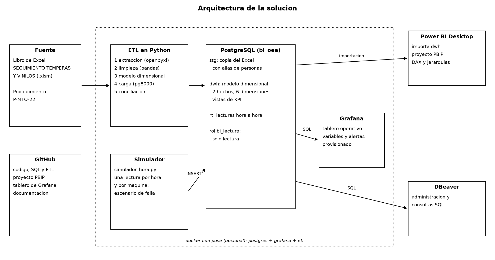
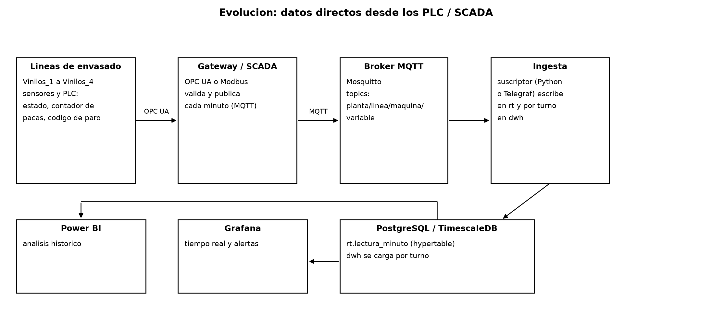

# 7. Arquitectura, comparativo y evolución

## Arquitectura de la solución

| Componente | Qué hace |
|---|---|
| Libro de Excel | Fuente histórica (hoja `Base De Datos` y catálogos). Se lee, no se modifica |
| ETL en Python | Extrae, limpia, arma el modelo, carga y concilia. Un solo comando: `python etl/run_etl.py` |
| PostgreSQL `bi_oee` | `stg` guarda la copia del Excel, `dwh` el modelo dimensional y las vistas de KPI, `rt` las lecturas hora a hora |
| Simulador | `etl/simulador_hora.py` escribe una lectura por hora y por máquina en `rt.lectura_hora`, con un escenario de falla para probar la alerta |
| Power BI Desktop | Importa las tablas de `dwh`. El proyecto está en formato PBIP (texto) para versionarlo |
| Grafana | Lee `rt` y `dwh`. El data source, el tablero y las alertas se cargan solos al iniciar (provisioning) |
| DBeaver | Administración y consultas SQL sobre PostgreSQL |
| GitHub | Código, SQL, ETL, proyecto PBIP, tablero de Grafana exportado y documentación |
| Docker compose (opcional) | Levanta PostgreSQL, Grafana y el ETL con un solo comando |

Power BI y DBeaver se ejecutan en el equipo del usuario y se conectan a los servicios, que pueden estar en contenedores.

## Power BI y Grafana: por qué no se intercambian

| Criterio | Power BI | Grafana |
|---|---|---|
| Pregunta que resuelve | ¿Cómo hemos estado y por qué? Comparar años, máquinas y turnos, priorizar causas | ¿Qué está pasando ahora y debo actuar? |
| Usuario | Dirección, mantenimiento, jefe de producción | Operarias, supervisor de turno, técnicos |
| Frecuencia de actualización | Programada: por ejemplo una vez al día. En el servicio compartido el máximo son 8 actualizaciones diarias | Segundos: el tablero refresca cada 5 s y las alertas se evalúan cada 10 s |
| Origen | Modelo importado (copia en memoria) desde `dwh` | Consulta directa a PostgreSQL en cada panel (`rt`) |
| Modelo y lenguaje | Modelo semántico en estrella, relaciones, jerarquías y medidas DAX | Sin modelo propio: cada panel es una consulta SQL |
| Lo que hace mejor | Inteligencia de tiempo (año anterior, acumulado del año), Pareto, drill-down por la jerarquía de paros, matrices | Series de tiempo continuas, estado actual por máquina, alertas por umbral, variables de tablero |
| Alertas | Limitadas: se evalúan al actualizar los datos | Reglas propias con contact points y evaluación continua |
| Ejemplo en este proyecto | OEE por máquina y año, Pareto de paros, comparativo contra el año anterior | Estado de cada máquina, paro de las últimas 3 horas, alerta si pasa del 50 % |

**Por qué no se intercambian.** Un modelo importado en Power BI es una foto: no se pensó para refrescarse cada pocos segundos ni para vigilar un umbral y avisar. Y Grafana no tiene un modelo semántico: comparar contra el mismo periodo del año anterior, acumular por año o armar un Pareto con porcentaje acumulado sobre una jerarquía exige medidas y relaciones que Grafana no ofrece y que habría que reescribir en SQL en cada panel. Cada herramienta atiende una frecuencia y un usuario distintos sobre la misma base.

## Evolución: datos directos de los PLC o del SCADA

Hoy el dato nace en un formato de papel que se transcribe a Excel. Si las máquinas entregaran los datos directamente:

1. **Qué se lee.** En el PLC de cada línea: estado (marcha o paro), contador de pacas, velocidad y el código de paro que la operaria selecciona en el panel o en una tableta (los 18 códigos actuales).
2. **Cómo viaja.** Una pasarela (OPC UA o Modbus) valida y publica cada minuto por MQTT en topics como `planta/linea/vinilos_3/pacas`. El broker (Mosquitto) desacopla las máquinas de quien consume.
3. **Dónde llega.** Un suscriptor (un servicio en Python o Telegraf) escribe las lecturas por minuto en `rt.lectura_minuto`, que pasa a ser una hypertable de TimescaleDB (extensión de PostgreSQL), y registra cada paro como evento.
4. **Qué cambia en el modelo.** Nada en las dimensiones ni en Power BI. `fact_paro` se carga por turno desde los eventos reales en lugar de las filas del Excel, y `rt` pasa de lecturas por hora a lecturas por minuto.
5. **Qué mejora.** Desaparecen la transcripción manual, los duplicados, las columnas corridas y los registros que faltan. MTTR y MTBF se miden sin depender de que alguien anote el paro, y las alertas de Grafana trabajan con datos reales.
6. **Qué hay que cuidar.** Separar la red de planta (OT) de la de oficina (IT), guardar los datos en la pasarela si se cae la red, sincronizar los relojes, usar TLS y usuarios por servicio con permisos mínimos, y definir un contrato de datos (nombres, unidades y frecuencia) para que un cambio en el PLC no rompa el tablero sin aviso.
7. **Qué sigue siendo manual.** El motivo del paro (el PLC sabe que paró, no por qué): la operaria debe seleccionarlo, y ahí se necesita una validación para que el catálogo de códigos no vuelva a tener variantes.
